

<a href="https://github.com/blue-sniffer">
  
</a>

 

---

## 👋 About Me

I'm a Master's student in Information Technology at **EPITECH Paris** (RNCP7, Bac+5, Promo 2027), looking for a **12-month alternance**. My background spans software engineering (PL/SQL and production-issue diagnosis at PwC), full-stack development, data and automation, and infrastructure and security work.

What ties it together is a practical, problem-solving mindset: understand how a system behaves under real constraints, then make it more reliable, more secure, or easier for the people using it. I document what I build and test before I call something done.

## 💼 What I Work On

- 🗄️ **Software engineering:** PL/SQL and production-issue diagnosis at PwC
- 🌐 **Full-stack:** React, Django REST, PostgreSQL and Docker
- 📊 **Data & automation:** Power BI, Python, Apache Airflow, and an AI agent that automates multi-source data collection and validation
- 🔐 **Infrastructure & security:** recovering and hardening a multi-VM platform, and vulnerability remediation in controlled environments
- 🧭 **Delivery:** sprint reviews, risk tracking and stakeholder communication on a multi-team capstone project

## 🛠️ Tech Stack

<a href="https://github.com/blue-sniffer?tab=repositories">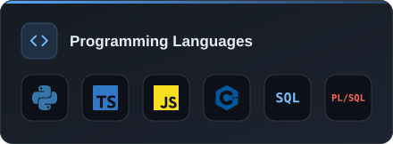</a>
<a href="https://github.com/blue-sniffer?tab=repositories">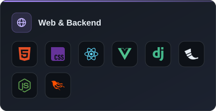</a>
 
<a href="https://github.com/blue-sniffer?tab=repositories">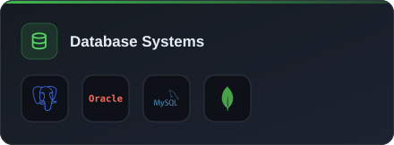</a>
<a href="https://github.com/blue-sniffer?tab=repositories">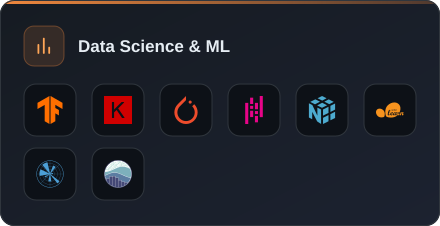</a>
 
<a href="https://github.com/blue-sniffer?tab=repositories">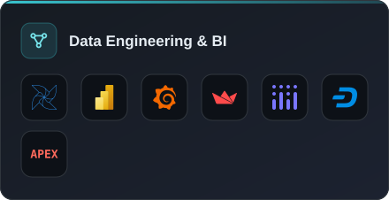</a>
<a href="https://tryhackme.com/p/Ezio.316">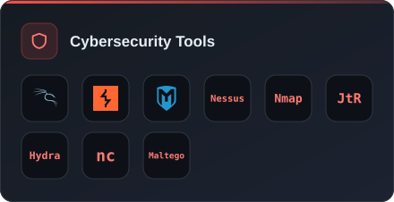</a>
 
<a href="https://github.com/blue-sniffer?tab=repositories">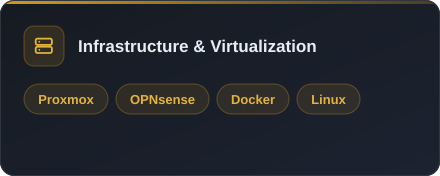</a>
<a href="https://github.com/blue-sniffer?tab=repositories">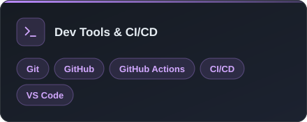</a>

## 🚀 Projects

<a href="https://github.com/blue-sniffer/Rao-Muhammad-Mueez">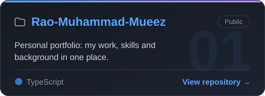</a>
<a href="https://github.com/blue-sniffer/GroceryGo-Application">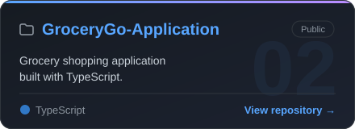</a>
 
<a href="https://github.com/blue-sniffer/Trinity---DevWeb_">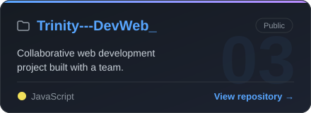</a>
<a href="https://github.com/blue-sniffer/CIA">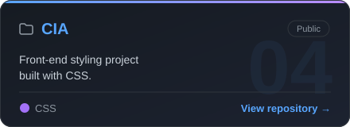</a>

 

**Collaborations:** [Trinity_Dev_Web](https://github.com/HadeedRauf/Trinity_Dev_Web) · [360framework](https://github.com/eliezaylaa/360framework)

[**→ See all repositories**](https://github.com/blue-sniffer?tab=repositories)

<!-- To add a project: copy one card in assets/ (or ask Claude to generate one), then add a matching  line above. -->

## 📫 Let's Connect

I'm open to opportunities in **software engineering, data, infrastructure/security, or IT project delivery**, and I'm looking for a 12-month alternance. The fastest way to reach me is [LinkedIn](https://www.linkedin.com/in/rao-muhammad-mueez/) or [email](mailto:raomuhammadmueez@fgmail.com).
